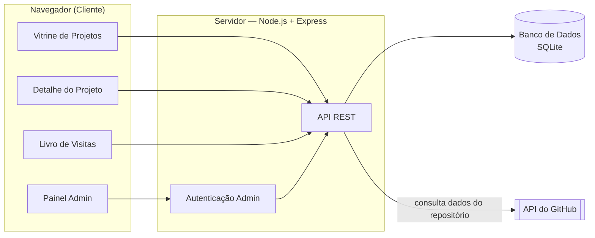

# Proposta e Especificação do Projeto — Etapa 01

## Nome da aplicação

**DevFolio** — Portfólio e Vitrine de Projetos

*(nome de trabalho; pode ser personalizado livremente nas próximas etapas)*

## Descrição do problema

Desenvolvedores que querem mostrar seus projetos normalmente usam um destes dois caminhos: um currículo estático em PDF, que fica desatualizado rápido, ou uma página HTML fixa, onde cada novo projeto exige abrir o código, editar HTML e publicar de novo. Nenhum dos dois resolve bem o problema de manter uma vitrine de trabalho **sempre atualizada** e ao mesmo tempo **fácil de manter**.

O DevFolio resolve isso oferecendo um painel administrativo simples onde o próprio autor cadastra, edita e remove projetos sem tocar em código, enquanto o site público exibe essas informações de forma visual e organizada — funcionando como um currículo técnico vivo. Para reforçar o caráter de aplicação real (e não apenas uma página estática), o site também permite que visitantes interajam deixando mensagens em um livro de visitas, e busca automaticamente dados atualizados dos repositórios diretamente da API do GitHub.

**Importante — é um sistema single-tenant, não uma plataforma multiusuário:** o DevFolio é o portfólio de uma única pessoa (o autor). Existe apenas uma conta de administrador, pré-configurada, sem qualquer tela ou rota pública de cadastro — ninguém além do autor consegue criar conta, logar como admin ou cadastrar projetos próprios. Visitantes só têm acesso de leitura ao conteúdo e à interação prevista (livro de visitas); eles nunca criam, editam ou gerenciam projetos. O CRUD de projetos existe unicamente para o autor manter o próprio conteúdo sem precisar editar código — não é uma ferramenta para terceiros hospedarem os portfólios deles.

## Público-alvo

- Recrutadores e times técnicos avaliando o autor para vagas ou projetos.
- Colegas de curso, professores e comunidade dev interessados em conhecer os projetos.
- Potenciais clientes ou colaboradores em busca de referências de trabalhos anteriores.

## Objetivo principal da aplicação

Oferecer uma vitrine interativa e sempre atualizada dos projetos pessoais do autor, com manutenção simples via painel administrativo (sem precisar editar código a cada novo projeto) e com um canal de interação para quem visita o site.

## Funcionalidades (mínimo 5)

1. **Vitrine de projetos** — grade visual de cards com filtro por tecnologia/categoria e busca por palavra-chave.
2. **Página de detalhes do projeto** — descrição completa, tecnologias usadas, links para repositório/demo e capturas de tela.
3. **Painel administrativo protegido por login** — acesso restrito à conta única do autor, para criar, editar e remover projetos (sem cadastro público de novos usuários administradores).
4. **Livro de visitas** — qualquer visitante pode deixar nome e mensagem, visíveis publicamente.
5. **Integração com a API do GitHub** — busca e exibe dados atualizados de cada repositório (estrelas, linguagem principal, data do último commit).
6. **Busca e filtro de projetos** — por tecnologia ou palavra-chave, direto na vitrine.

## Entidades / conceitos do domínio (mínimo 3)

1. **Projeto** — título, descrição curta e longa, URL do repositório GitHub, URL de demo (opcional), imagem de capa, data de cadastro.
2. **Tecnologia** — nome e categoria (linguagem, framework, ferramenta); associada a um ou mais projetos (relação N:N).
3. **Comentário** — nome do visitante, mensagem, data (livro de visitas).
4. **Administrador** — usuário e senha (com hash). Conta **única e pré-configurada**, pertencente exclusivamente ao autor; não existe operação de cadastro público de novos administradores.

## Telas / interfaces (mínimo 3)

1. **Home / Vitrine** — apresentação pessoal (hero) + grade de projetos com filtro por tecnologia.
2. **Detalhe do projeto** — informações completas do projeto, dados vindos da API do GitHub, tecnologias usadas e links.
3. **Livro de visitas** — lista de mensagens de visitantes + formulário para novo comentário.
4. **Painel administrativo** — tela de login e, após autenticado, listagem de projetos com opções de criar, editar e remover.

## Operações (mínimo 5)

1. Autenticar administrador (login) e iniciar sessão. *(não há operação de cadastro de novo administrador — a conta é única e pré-configurada)*
2. Criar um novo projeto, associando tecnologias.
3. Editar um projeto existente.
4. Remover um projeto.
5. Listar/filtrar projetos por tecnologia ou palavra-chave.
6. Registrar um novo comentário no livro de visitas.
7. Listar comentários do livro de visitas.
8. Consultar e armazenar dados atualizados de um repositório via API do GitHub.

## Tecnologias — cliente

- HTML5 e CSS3 (variáveis, grid/flexbox, transições)
- JavaScript (Vanilla, ES6+)
- Biblioteca leve de animação para efeitos visuais de entrada/scroll (ex.: AOS — Animate On Scroll)

## Tecnologias — servidor

- Node.js + Express.js
- Autenticação simples via sessão/cookie ou JWT (apenas para a conta única de administrador)
- Consumo da API pública do GitHub (via `fetch`)

## Tecnologia de persistência

- **SQLite**, acessado via um ORM leve (Sequelize ou Prisma). Escolhido por não exigir um servidor de banco separado nesta fase inicial, mantendo o setup simples, e por ser fácil de trocar por Postgres/MySQL mais adiante caso necessário.

## Diagrama simples da solução

O cliente (navegador) consome uma API REST fornecida pelo servidor Express. O servidor lê e grava dados no SQLite (projetos, tecnologias, comentários, administrador) e, quando necessário, consulta a API pública do GitHub para enriquecer as informações de cada projeto.

## Observação sobre escopo

Esta é a especificação inicial da Etapa 01. As tecnologias e o detalhamento poderão evoluir ao longo do semestre, mantendo a coerência da solução, conforme permitido pelas regras da disciplina.
