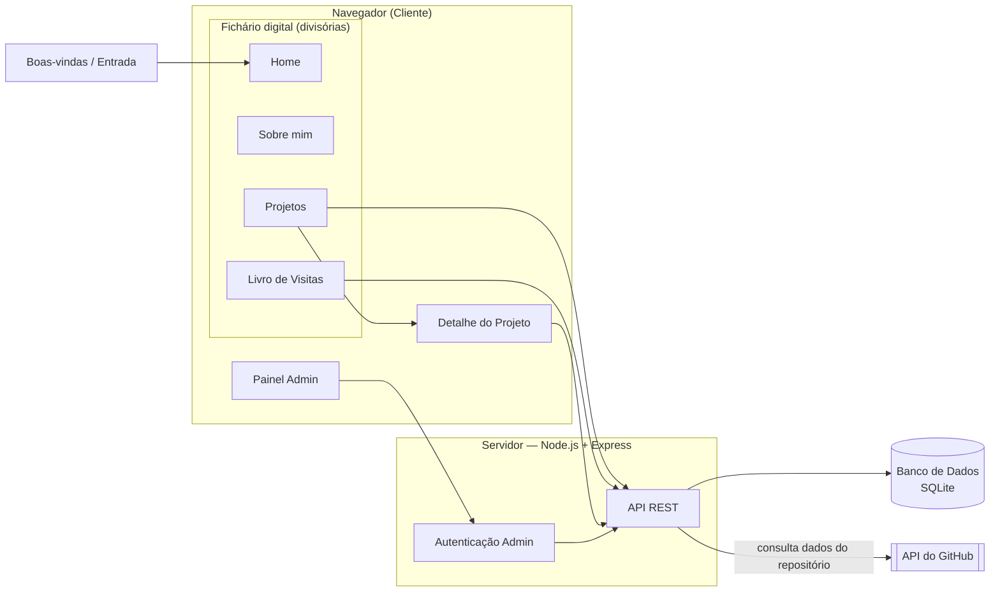

# Proposta e Especificação do Projeto — Etapa 01

## Nome da aplicação

**DevFolio** — Portfólio e Vitrine de Projetos

*(nome de trabalho; pode ser personalizado livremente nas próximas etapas)*

## Descrição do problema

Desenvolvedores que querem mostrar seus projetos normalmente usam um destes dois caminhos: um currículo estático em PDF, que fica desatualizado rápido, ou uma página HTML fixa, onde cada novo projeto exige abrir o código, editar HTML e publicar de novo. Nenhum dos dois resolve bem o problema de manter uma vitrine de trabalho **sempre atualizada**, fácil de manter e, ao mesmo tempo, **memorável** — a maioria dos portfólios de dev é visualmente genérica e não se diferencia.

O DevFolio resolve isso de duas formas. Primeiro, oferecendo um painel administrativo simples onde o próprio autor cadastra, edita e remove projetos sem tocar em código, enquanto o site público exibe essas informações de forma organizada — funcionando como um currículo técnico vivo. Segundo, apresentando esse conteúdo através de uma experiência visual própria e autoral: uma tela de entrada com uma animação de cursor criativa, seguida por um portfólio no formato de um **fichário/journal digital interativo**, navegável por divisórias temáticas e com efeito de virar página, em vez do formato tradicional de "scroll infinito" que a maioria dos portfólios usa. Para reforçar o caráter de aplicação real (e não apenas uma página estática), o site também permite que visitantes interajam deixando mensagens em um livro de visitas, e busca automaticamente dados atualizados dos repositórios diretamente da API do GitHub.

**Importante — é um sistema single-tenant, não uma plataforma multiusuário:** o DevFolio é o portfólio de uma única pessoa (o autor). Existe apenas uma conta de administrador, pré-configurada, sem qualquer tela ou rota pública de cadastro — ninguém além do autor consegue criar conta, logar como admin ou cadastrar projetos próprios. Visitantes só têm acesso de leitura ao conteúdo e à interação prevista (livro de visitas); eles nunca criam, editam ou gerenciam projetos. O CRUD de projetos existe unicamente para o autor manter o próprio conteúdo sem precisar editar código — não é uma ferramenta para terceiros hospedarem os portfólios deles.

**Decisão técnica registrada:** avaliamos usar uma cena 3D navegável (Three.js/WebGL) para a experiência do fichário, mas optamos por **não** seguir esse caminho nesta etapa. O efeito de fichário/livro é implementado inteiramente com CSS (transformações 3D como `perspective`/`rotateY`) e Canvas 2D, o que entrega uma experiência visual muito similar sem a complexidade de um motor 3D completo — mantendo o projeto mais fácil de dominar e explicar dentro do prazo do semestre.

## Público-alvo

- Recrutadores e times técnicos avaliando o autor para vagas ou projetos.
- Colegas de curso, professores e comunidade dev interessados em conhecer os projetos.
- Potenciais clientes ou colaboradores em busca de referências de trabalhos anteriores.

## Objetivo principal da aplicação

Oferecer uma vitrine interativa, visualmente marcante e sempre atualizada dos projetos pessoais do autor — em formato de fichário digital — com manutenção simples via painel administrativo (sem precisar editar código a cada novo projeto) e com um canal de interação para quem visita o site.

## Funcionalidades (mínimo 5)

1. **Tela de boas-vindas / entrada** — animação de cursor criativa (efeito de partículas que reage ao movimento do mouse), links para redes sociais e botão para entrar no portfólio.
2. **Fichário/journal digital interativo** — o portfólio em si, navegável por divisórias temáticas (Home, Sobre mim, Projetos, Livro de Visitas), com identidade visual autoral.
3. **Efeito de virar página** — dentro de cada divisória, o visitante folheia o conteúdo usando setas, com animação de página virando.
4. **Trilha sonora ambiente** — música de fundo opcional, com controle de tocar/pausar e volume.
5. **Painel administrativo protegido por login** — acesso restrito à conta única do autor, para criar, editar e remover projetos (sem cadastro público de novos usuários administradores).
6. **Livro de visitas** — qualquer visitante pode deixar nome e mensagem, visíveis publicamente.
7. **Integração com a API do GitHub** — busca e exibe dados atualizados de cada repositório (estrelas, linguagem principal, data do último commit).
8. **Busca e filtro de projetos** — por tecnologia ou palavra-chave, dentro da divisória de projetos.

## Entidades / conceitos do domínio (mínimo 3)

1. **Projeto** — título, descrição curta e longa, URL do repositório GitHub, URL de demo (opcional), imagem de capa, data de cadastro.
2. **Tecnologia** — nome e categoria (linguagem, framework, ferramenta); associada a um ou mais projetos (relação N:N).
3. **Comentário** — nome do visitante, mensagem, data (livro de visitas).
4. **Administrador** — usuário e senha (com hash). Conta **única e pré-configurada**, pertencente exclusivamente ao autor; não existe operação de cadastro público de novos administradores.

## Telas / interfaces (mínimo 3)

1. **Boas-vindas / Entrada** — tela de carregamento com cursor animado (partículas), links de redes sociais e botão para entrar.
2. **Home** (divisória do fichário) — abertura do fichário, apresentação inicial do autor.
3. **Sobre mim** (divisória) — bio, trajetória e principais habilidades.
4. **Projetos** (divisória) — páginas folheáveis com um resumo/card de cada projeto cadastrado.
5. **Detalhe do Projeto** — página própria (fora do fichário) com descrição completa, tecnologias, links de repositório/demo e dados vindos da API do GitHub.
6. **Livro de Visitas** (divisória) — lista de mensagens de visitantes + formulário para novo comentário.
7. **Painel Administrativo** — tela de login e, após autenticado, listagem de projetos com opções de criar, editar e remover.

## Operações (mínimo 5)

1. Autenticar administrador (login) e iniciar sessão. *(não há operação de cadastro de novo administrador — a conta é única e pré-configurada)*
2. Criar um novo projeto, associando tecnologias.
3. Editar um projeto existente.
4. Remover um projeto.
5. Listar/filtrar projetos por tecnologia ou palavra-chave.
6. Registrar um novo comentário no livro de visitas.
7. Listar comentários do livro de visitas.
8. Consultar e armazenar dados atualizados de um repositório via API do GitHub.
9. Navegar entre páginas do fichário (avançar/voltar), disparando a animação de virar página.
10. Controlar a reprodução da música de fundo (tocar/pausar/volume).

## Tecnologias — cliente

- HTML5 e CSS3 (grid/flexbox, transformações 3D via CSS — `perspective` / `rotateY` — para o efeito de virar página do fichário)
- JavaScript (Vanilla, ES6+)
- Canvas 2D API — para a animação de partículas que acompanha o cursor na tela de entrada
- Elemento `<audio>` (Web Audio) — para a trilha sonora ambiente

## Tecnologias — servidor

- Node.js + Express.js
- Autenticação simples via sessão/cookie ou JWT (apenas para a conta única de administrador)
- Consumo da API pública do GitHub (via `fetch`)

## Tecnologia de persistência

- **SQLite**, acessado via um ORM leve (Sequelize ou Prisma). Escolhido por não exigir um servidor de banco separado nesta fase inicial, mantendo o setup simples, e por ser fácil de trocar por Postgres/MySQL mais adiante caso necessário.

## Diagrama simples da solução

O visitante entra pela tela de Boas-vindas e cai no fichário digital (Home/Sobre/Projetos/Livro de Visitas), que consome uma API REST fornecida pelo servidor Express. Ao abrir um projeto específico, sai do fichário para a página de Detalhe do Projeto. O servidor lê e grava dados no SQLite (projetos, tecnologias, comentários, administrador) e, quando necessário, consulta a API pública do GitHub para enriquecer as informações de cada projeto.

## Observação sobre escopo

Esta é a especificação inicial da Etapa 01. Dado o caráter visualmente ambicioso do fichário digital, a construção será feita em camadas ao longo do semestre: primeiro uma versão funcional simples (layout convencional, sem as animações), depois a introdução da tela de boas-vindas e do formato de fichário, e por fim os refinamentos visuais (partículas no cursor, efeito de virar página, música de fundo). Isso garante que sempre exista uma versão funcional para apresentar na auditoria, mesmo que os refinamentos visuais ainda estejam em progresso. Tecnologias e detalhamento poderão evoluir ao longo do semestre, mantendo a coerência da solução, conforme permitido pelas regras da disciplina.
